<div align="center">

<h3><code>arnav@github ~ $ ./contributions.sh</code></h3>



<br><br>

<h3><code>arnav@github ~ $ whoami</code></h3>

<table>
<tr>
<td valign="top">

</td>
<td valign="top">

</td>
</tr>
</table>

</div>

---

### `arnav@github ~ $ cat about.txt`

BTech student at IIT Jodhpur working on LLM training, evaluation and serving. I build the checks that tell you whether a model is right.

- **Now:** a small research model trained to cite only what a checker can verify (retrieval, an entailment model, a word-for-word quote check), and open LLMs served and benchmarked on one 12 GB GPU.
- **Before:** a voice research agent (2nd in Product at the Murf AI x IIT Bombay hackathon), an F1 strategy engine tested on a held-out season, and an autograd engine written by hand.
- **Open to:** research and engineering internships in LLM training, evaluation and inference.

### `arnav@github ~ $ cat stack.txt`

```text
languages   Python · C++ · TypeScript
ml          PyTorch · Hugging Face · LoRA/PEFT · vLLM · llama.cpp · scikit-learn
systems     FastAPI · Next.js · Postgres/Supabase · Docker · ROS 2 / ArduPilot
practice    held-out evaluation · paired bootstrap · ablations · reproducible runs
```

### `arnav@github ~ $ ls projects/`

- [**HUMBLE**](https://github.com/b25bb1004-wq/firstrun) — follows a repository's setup docs on a clean machine, repairs what breaks with evidence, replays from zero, and opens a PR with a README that provably works. 26 of 31 real open-source repos verified, 36 breaks fixed. Built for the IBM Bob 2.0 Hackathon. [Live demo](https://firstrun-sigma.vercel.app).
- [**Pitwall**](https://github.com/b25bb1004-wq/F1-Pitstop_Strategy) — F1 lap-time, tyre-degradation and pit-stop decision engine on 2021-2025 data, tested once on the 2025 season: 0.62 s mean error over 109,883 in-race predictions against 1.11 s for repeating the last lap. [Live app](https://b25bb1004-wq.github.io/F1-Pitstop_Strategy/).
- [**VOX**](https://github.com/b25bb1004-wq/murf-ai-iitb-hackathon) — real-time voice research agent: live transcription, streaming speech, RAG over PDFs, arXiv, web and patent tools. 2nd in Product, Murf AI x IIT Bombay Techfest.
- [**llm-from-scratch**](https://github.com/b25bb1004-wq/llm-from-scratch) — a GPT built from the ground up following Karpathy's Zero to Hero; micrograd with tests, makemore in progress.
- [**DESMOS Engine**](https://github.com/b25bb1004-wq/DESMOS_engine) — C++17 expression parser and function plotter: tokenizer, Shunting-Yard to RPN, stack evaluator.
- [**Spaghettify**](https://github.com/b25bb1004-wq/spaghettify) — an Electron/WebGL black hole that lenses your screen when you have worked too long.
- **Faith** (private research, IIT Jodhpur) — a small open model trained to answer research questions with citations a checker can verify; includes the benchmark, the verifier and the training loop.

### `arnav@github ~ $ contact`

- LinkedIn — [arnav-yadav-403033378](https://www.linkedin.com/in/arnav-yadav-403033378/)
- Email — [arnavyadav3008@gmail.com](mailto:arnavyadav3008@gmail.com) · [b25bb1004@iitj.ac.in](mailto:b25bb1004@iitj.ac.in)
- Site — [b25bb1004-wq.github.io](https://b25bb1004-wq.github.io)

<div align="center">
<code>build → measure → learn → repeat</code>
</div>
