  

  
  
  

  

<h3 align="center"><code>arnav@github ~ $ ls projects/</code></h3>

  
  
   
  
  
   
  
  

<h3 align="center"><code>arnav@github ~ $ cat toolbox.txt</code></h3>

  

<h3 align="center"><code>arnav@github ~ $ ./contributions.sh</code></h3>

  

<code>build → measure → learn → repeat</code>

